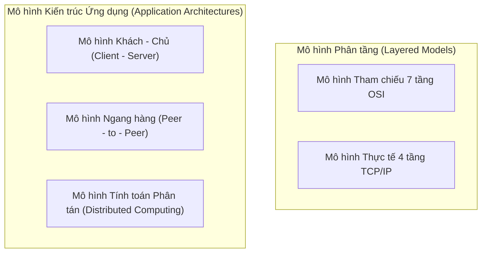

# BỘ GIÁO DỤC VÀ ĐÀO TẠO
## TRƯỜNG ĐẠI HỌC KỸ THUẬT ...
### KHOA CÔNG NGHỆ THÔNG TIN - BỘ MÔN MẠNG MÁY TÍNH VÀ TRUYỀN THÔNG
***

   

# BÁO CÁO ĐỒ ÁN HỌC PHẦN: LẬP TRÌNH MẠNG

 

# ĐỀ TÀI:
# XÂY DỰNG HỆ THỐNG PHÁT HIỆN VÀ NGĂN CHẶN XÂM NHẬP MẠNG ĐA TẦNG (NIDS & HIPS) DỰA TRÊN PHÂN TÍCH GIAO THỨC TCP/IP, HTTP THEO MÔ HÌNH CLIENT–SERVER PHÂN TÁN

   

**Sinh viên thực hiện :** ĐÀM VĂN NGUYÊN  
**Mã số sinh viên     :** 24IT180  
**Lớp                 :** 24IT...  
**Giảng viên hướng dẫn:** ThS. Huỳnh Công Pháp  

  

**Năm học:** 2025 - 2026  
**Thành phố Đà Nẵng**

---

\newpage

# THÔNG TIN TỔNG QUAN VỀ ĐỀ TÀI

### 1. Tên đề tài (IN HOA)
**XÂY DỰNG HỆ THỐNG PHÁT HIỆN VÀ NGĂN CHẶN XÂM NHẬP MẠNG ĐA TẦNG (NIDS & HIPS) DỰA TRÊN PHÂN TÍCH GIAO THỨC TCP/IP, HTTP THEO MÔ HÌNH CLIENT–SERVER PHÂN TÁN**

### 2. Đối tượng sử dụng
* **Kỹ sư Quản trị Mạng và Hệ thống (Network & System Administrators):** Cần một giải pháp an ninh "cắm-và-chạy" (Plug-and-Play), có thể triển khai giám sát và bảo vệ các máy chủ Web (đặc biệt là các hệ thống Legacy không thể chỉnh sửa mã nguồn) mà không làm suy giảm hiệu năng hay gây gián đoạn đường truyền.
* **Chuyên viên Trung tâm Điều hành An ninh Mạng (SOC Analysts / Blue Team):** Cần công cụ phân tích lưu lượng mạng tầng sâu (Deep Packet Inspection), phát hiện tấn công theo thời gian thực, lưu vết nhật ký an ninh và tự động phản đòn cô lập địa chỉ IP tấn công ngay tại lớp nhân hệ điều hành (OS Kernel).
* **Môi trường Giảng dạy và Đào tạo Chuyên ngành Mạng máy tính:** Sinh viên, giảng viên và nghiên cứu sinh cần một mô hình trực quan để phân tích đường đi của các đơn vị dữ liệu giao thức (PDU) qua 7 tầng OSI, sự phối hợp giữa các giao thức HTTP, TCP, UDP và cơ chế chặn gói tin tại nhân hệ điều hành.

### 3. Mục tiêu sử dụng
* **Mục tiêu học thuật:** Hiện thực hóa các nguyên lý lập trình mạng nâng cao: cơ chế Socket đa dạng (Raw Socket, TCP Stream Socket, UDP Datagram Socket), lập trình đa luồng (Multithreading), kiểm soát tắc nghẽn, điều phối tài nguyên máy chủ bằng cơ chế đèn báo hiệu (Semaphore) và truyền thông điệp liên tiến trình (IPC) phân tán.
* **Mục tiêu kỹ thuật:** Xây dựng hệ thống phòng thủ phân tán 3 thành phần độc lập:
  1. *Phân hệ Nạn nhân (`server.py`):* Máy chủ Web xử lý giao dịch dịch vụ ngân hàng/thương mại điện tử có giới hạn tải, phản hồi HTTP 503 khi quá tải DoS.
  2. *Phân hệ Giám sát (`nids_engine.py`):* Hoạt động ở chế độ hỗn tạp (Promiscuous Mode), bắt gói tin thô không gây trễ, phân tích chữ ký L7 (SQLi, XSS) và tần suất L4 (Sliding Window DoS).
  3. *Phân hệ Hành pháp (`hips_guard.py`):* Tiếp nhận cảnh báo qua UDP IPC được bảo vệ bằng mã xác thực HMAC-SHA256, tự động nạp luật chặn vào Tường lửa Windows (Windows Filtering Platform) qua lệnh `netsh` và tự động hẹn giờ mở khóa sau 60 giây.
* **Mục tiêu kiểm chứng:** Xây dựng bộ công cụ kiểm thử xâm nhập chuyên nghiệp có giao diện đồ họa (`attacker_gui.py`) để đo lường độ trễ phản xạ (Reaction Latency) và thực nghiệm đối chứng A/B (Chưa có phòng thủ vs Đã bật phòng thủ).

### 4. Phạm vi và bài toán giải quyết
* **Phạm vi mạng:** Triển khai trên môi trường mạng cục bộ LAN hoặc mạng ảo hóa phân tán (mạng ảo VMware/VirtualBox subnet `192.168.144.0/24` giữa máy tấn công Ubuntu Linux và máy phòng thủ Windows 11 Host).
* **Phạm vi giao thức:** Bao phủ toàn diện các giao thức chủ chốt: HTTP/1.1 (Tầng Ứng dụng), TCP và UDP (Tầng Giao vận), IP (Tầng Mạng) và ARP/Ethernet (Tầng Liên kết dữ liệu).
* **Bài toán giải quyết:** Giải quyết triệt để nhược điểm của các hệ thống bảo mật nội bộ tầng ứng dụng (Application-level Security) bằng cách chặn đứng các cuộc tấn công DoS Flooding, SQL Injection và Cross-Site Scripting ngay tại tầng Network/Transport của Kernel, giữ cho bộ đệm Socket (Socket Receive Buffer) và các luồng của Web Server luôn trong trạng thái an toàn.

### 5. Hướng phát triển của sản phẩm
* Nâng cấp cơ chế lọc gói tin trên môi trường Linux bằng công nghệ **eBPF (Extended Berkeley Packet Filter)** và **XDP (eXpress Data Path)** cho phép loại bỏ gói tin trực tiếp trên bộ nhớ Card mạng (NIC ring buffer) với độ trễ micro-giây ($\mu\text{s}$).
* Tích hợp các mô hình Trí tuệ nhân tạo (Machine Learning / Deep Learning) để phát hiện hành vi bất thường (Anomaly Detection), nhận diện các cuộc tấn công Zero-day mà không phụ thuộc vào biểu thức chính quy (Regex) tĩnh.
* Hỗ trợ giải mã lưu lượng mã hóa HTTPS/TLS thông qua cơ chế eBPF SSL Sniffing hoặc kết hợp làm việc với các hệ thống Reverse Proxy (Nginx, HAProxy).

---

\newpage

# MỤC LỤC

- [THÔNG TIN TỔNG QUAN VỀ ĐỀ TÀI](#thông-tin-tổng-quan-về-đề-tài)
- [CHƯƠNG 1: CƠ SỞ LÝ THUYẾT VÀ CƠ SỞ CÔNG NGHỆ](#chương-1-cơ-sở-lý-thuyết-và-cơ-sở-công-nghệ)
  - [1.1. Giới thiệu sơ lược về Lập trình Mạng](#11-giới-thiệu-sơ-lược-về-lập-trình-mạng)
  - [1.2. Các mô hình trong Lập trình Mạng](#12-các-mô-hình-trong-lập-trình-mạng)
    - [1.2.1. Mô hình tham chiếu 7 tầng OSI](#121-mô-hình-tham-chiếu-7-tầng-osi)
    - [1.2.2. Mô hình 4 tầng TCP/IP](#122-mô-hình-4-tầng-tcpip)
    - [1.2.3. Mô hình Khách - Chủ (Client - Server)](#123-mô-hình-khách---chủ-client---server)
    - [1.2.4. Mô hình Mạng Ngang hàng (Peer-to-Peer - P2P)](#124-mô-hình-mạng-ngang-hàng-peer-to-peer---p2p)
    - [1.2.5. Mô hình Tính toán Phân tán (Distributed Computing Architecture)](#125-mô-hình-tính-toán-phân-tán-distributed-computing-architecture)
  - [1.3. Các giao thức mạng theo tầng](#13-các-giao-thức-mạng-theo-tầng)
    - [1.3.1. Các giao thức Tầng Ứng dụng (HTTP, FTP, SMTP, DNS)](#131-các-giao-thức-tầng-ứng-dụng-http-ftp-smtp-dns)
    - [1.3.2. Các giao thức Tầng Giao vận (TCP, UDP)](#132-các-giao-thức-tầng-giao-vận-tcp-udp)
    - [1.3.3. Các giao thức Tầng Mạng (IP, ICMP)](#133-các-giao-thức-tầng-mạng-ip-icmp)
    - [1.3.4. Giao thức Tầng Liên kết dữ liệu (ARP)](#134-giao-thức-tầng-liên-kết-dữ-liệu-arp)
  - [1.4. Quá trình Đóng gói (Encapsulation) và Mở gói (Decapsulation) PDU](#14-quá-trình-đóng-gói-encapsulation-và-mở-gói-decapsulation-pdu)
  - [1.5. Sơ lược về Java trong Lập trình Mạng](#15-sơ-lược-về-java-trong-lập-trình-mạng)
    - [1.5.1. Cơ chế Socket hướng nối và không hướng nối trong Java](#151-cơ-chế-socket-hướng-nối-và-không-hướng-nối-trong-java)
    - [1.5.2. Lập trình Đa luồng (Multithreading) và Quản lý đồng bộ](#152-lập-trình-đa-luồng-multithreading-và-quản-lý-đồng-bộ)
    - [1.5.3. Kết nối Cơ sở dữ liệu qua mạng với JDBC](#153-kết-nối-cơ-sở-dữ-liệu-qua-mạng-với-jdbc)
- [CHƯƠNG 2: PHÂN TÍCH VÀ THIẾT KẾ HỆ THỐNG](#chương-2-phân-tích-và-thiết-kế-hệ-thống)
  - [2.1. Giới thiệu sơ lược bài toán cần thực hiện](#21-giới-thiệu-sơ-lược-bài-toán-cần-thực-hiện)
  - [2.2. Mô hình hóa tổng quát kiến trúc hệ thống](#22-mô-hình-hóa-tổng-quát-kiến-trúc-hệ-thống)
    - [2.2.1. Các mô hình cấu trúc liên kết mạng (Network Topologies)](#221-các-mô-hình-cấu-trúc-liên-kết-mạng-network-topologies)
    - [2.2.2. Nguyên lý hai máy kết nối và truyền thông qua mạng](#222-nguyên-lý-hai-máy-kết-nối-và-truyền-thông-qua-mạng)
    - [2.2.3. Đường đi thông điệp qua 7 tầng và cơ chế chặn gói tin tại Kernel](#223-đường-đi-thông-điệp-qua-7-tầng-và-cơ-chế-chặn-gói-tin-tại-kernel)
  - [2.3. Mô hình Phân tích và Thiết kế Hướng đối tượng (OOP)](#23-mô-hình-phân-tích-và-thiết-kế-hướng-đối-tượng-oop)
    - [2.3.1. Biểu đồ lớp tổng quát (UML Class Diagram)](#231-biểu-đồ-lớp-tổng-quát-uml-class-diagram)
    - [2.3.2. Biểu đồ tuần tự (Sequence Diagram) các kịch bản](#232-biểu-đồ-tuần-tự-sequence-diagram-các-kịch-bản)
    - [2.3.3. Phân tích chi tiết các Lớp, Thuộc tính và Phương thức](#233-phân-tích-chi-tiết-các-lớp-thuộc-tính-và-phương-thức)
    - [2.3.4. Các thuật toán then chốt trong đồ án](#234-các-thuật-toán-then-chốt-trong-đồ-án)
    - [2.3.5. Đối chiếu chuyên sâu giữa Java và Python trong Lập trình Mạng](#235-đối-chiếu-chuyên-sâu-giữa-java-và-python-trong-lập-trình-mạng)
- [CHƯƠNG 3: CÀI ĐẶT, KIỂM THỬ VÀ KẾT QUẢ ĐẠT ĐƯỢC](#chương-3-cài-đặt-kiểm-thử-và-kết-quả-đạt-được)
  - [3.1. Mô tả giao diện các phân hệ](#31-mô-tả-giao-diện-các-phân-hệ)
  - [3.2. Hướng dẫn vận hành và Kịch bản kiểm thử đối chứng](#32-hướng-dẫn-vận-hành-và-kịch-bản-kiểm-thử-đối-chứng)
  - [3.3. Đánh giá độ trễ phản xạ và tính có thực của Tường lửa](#33-đánh-giá-độ-trễ-phản-xạ-và-tính-có-thực-của-tường-lửa)
- [KẾT LUẬN VÀ HƯỚNG PHÁT TRIỂN](#kết-luận-và-hướng-phát-triển)
  - [1. Kiến thức thu hoạch được sau môn học](#1-kiến-thức-thu-hoạch-được-sau-môn-học)
  - [2. Kết quả đạt được so với mục tiêu đề ra](#2-kết-quả-đạt-được-so-với-mục-tiêu-đề-ra)
  - [3. Những tồn tại và hạn chế do giới hạn thời gian](#3-những-tồn-tại-và-hạn-chế-do-giới-hạn-thời-gian)
  - [4. Hướng phát triển trong tương lai](#4-hướng-phát-triển-trong-tương-lai)
- [DANH MỤC TÀI LIỆU THAM KHẢO](#danh-mục-tài-liệu-tham-khảo)

---

\newpage

# CHƯƠNG 1: CƠ SỞ LÝ THUYẾT VÀ CƠ SỞ CÔNG NGHỆ

## 1.1. Giới thiệu sơ lược về Lập trình Mạng
Lập trình Mạng (Network Programming) là lĩnh vực kỹ thuật phần mềm tập trung vào việc thiết kế, cài đặt và tối ưu hóa các chương trình ứng dụng có khả năng giao tiếp, trao đổi dữ liệu xuyên suốt qua môi trường mạng máy tính. 

Trong kiến trúc máy tính hiện đại, các tiến trình (Processes) thực thi trên cùng một máy tính có thể giao tiếp với nhau thông qua bộ nhớ chia sẻ (Shared Memory), đường ống (Pipes) hoặc hàng đợi thông điệp (Message Queues). Tuy nhiên, khi hai tiến trình nằm trên hai thiết bị phần cứng độc lập cách xa nhau về mặt địa lý, cơ chế duy nhất để kết nối chúng là mạng máy tính thông qua chuẩn giao diện **Giao diện Socket (Berkeley Sockets API)**.

Socket là một điểm cuối trừu tượng (Abstract Endpoint) được cung cấp bởi Hệ điều hành. Khi một ứng dụng mở một socket, Hệ điều hành sẽ cấp phát một cấu trúc dữ liệu nội bộ bao gồm các bộ đệm gửi (Send Buffer), bộ đệm nhận (Receive Buffer), các con trỏ trạng thái giao thức và ánh xạ nó vào bảng quản lý tệp của tiến trình (File Descriptor Table). Một phiên truyền thông liên mạng giữa hai ứng dụng được định danh tuyệt đối bởi **Bộ ngũ (5-tuple)**:
$$\text{Connection ID} = \langle \text{Source IP}, \text{Source Port}, \text{Destination IP}, \text{Destination Port}, \text{Transport Protocol} \rangle$$

Lập trình mạng đòi hỏi người kỹ sư không chỉ nắm vững ngôn ngữ lập trình (như Java, C/C++, Python) mà còn phải am hiểu sâu sắc về kiến trúc ngăn xếp giao thức (Protocol Stack), cơ chế đóng gói dữ liệu, tính toán thời gian trễ (RTT - Round Trip Time), điều khiển luồng (Flow Control), kiểm soát tắc nghẽn (Congestion Control) và các giải pháp an ninh mạng.

---

## 1.2. Các mô hình trong Lập trình Mạng

### 1.2.1. Mô hình tham chiếu 7 tầng OSI
Mô hình OSI (Open Systems Interconnection) được Tổ chức Tiêu chuẩn hóa Quốc tế (ISO) ban hành năm 1984 nhằm chuẩn hóa giao tiếp liên mạng thông qua 7 tầng trừu tượng độc lập:
1. **Tầng 7 - Ứng dụng (Application Layer):** Cung cấp giao diện trực tiếp cho các ứng dụng người dùng và dịch vụ mạng (HTTP, FTP, SMTP, DNS).
2. **Tầng 6 - Trình diễn (Presentation Layer):** Chịu trách nhiệm chuyển đổi định dạng dữ liệu (Data Formatting), mã hóa/giải mã (Encryption/Decryption) và nén dữ liệu (Compression).
3. **Tầng 5 - Phiên (Session Layer):** Thiết lập, duy trì, quản lý và đồng bộ hóa các phiên hội thoại (Dialogues) giữa hai ứng dụng đầu cuối.
4. **Tầng 4 - Giao vận (Transport Layer):** Cung cấp dịch vụ truyền dữ liệu đầu-cuối (End-to-End), chịu trách nhiệm phân đoạn dữ liệu, kiểm soát luồng, kiểm soát tắc nghẽn và khắc phục lỗi (TCP, UDP).
5. **Tầng 3 - Mạng (Network Layer):** Định vị địa chỉ logic (IPv4, IPv6) và quyết định đường đi tốt nhất cho gói tin qua các mạng khác nhau thông qua cơ chế định tuyến (Routing).
6. **Tầng 2 - Liên kết dữ liệu (Data Link Layer):** Chuyển đổi các bit nhị phân thành các khung dữ liệu (Frames), quản lý địa chỉ vật lý (MAC Address), điều khiển truy cập môi trường (MAC) và kiểm tra lỗi đường truyền (CRC/FCS).
7. **Tầng 1 - Vật lý (Physical Layer):** Chịu trách nhiệm truyền chuỗi bit thô (Raw Bit Stream) qua môi trường vật lý (cáp đồng, cáp quang, sóng vô tuyến) dưới dạng tín hiệu điện từ.

### 1.2.2. Mô hình 4 tầng TCP/IP
Mô hình TCP/IP (hay mô hình Internet) là kiến trúc thực tế được áp dụng trên mạng toàn cầu, tích hợp các tầng của OSI thành 4 tầng tinh gọn:
* **Tầng Ứng dụng (Application):** Tích hợp chức năng của Tầng 5, 6, 7 OSI.
* **Tầng Giao vận (Transport):** Tương đương Tầng 4 OSI (TCP, UDP).
* **Tầng Internet:** Tương đương Tầng 3 OSI (IP, ICMP, IGMP).
* **Tầng Truy cập Mạng (Network Access / Link Layer):** Tích hợp chức năng Tầng 1 và Tầng 2 OSI, tương tác trực tiếp với Driver card mạng và phần cứng.

### 1.2.3. Mô hình Khách - Chủ (Client - Server)
Mô hình Client-Server phân định vai trò rõ ràng giữa hai nút mạng:
* **Server (Máy chủ):** Lắng nghe bị động (Passive Open) tại một địa chỉ IP và cổng dịch vụ xác định. Máy chủ thường có tài nguyên phần cứng lớn, hoạt động liên tục (24/7) và có thể phục vụ đồng thời nhiều Client.
* **Client (Máy khách):** Khởi tạo chủ động (Active Open) kết nối tới Server khi cần yêu cầu tài nguyên hoặc dịch vụ.
* **Đặc tính:** Quản lý tập trung, dễ bảo mật và sao lưu dữ liệu, nhưng máy chủ là điểm lỗi đơn lẻ (Single Point of Failure) và dễ trở thành mục tiêu của các cuộc tấn công từ chối dịch vụ (DoS).

### 1.2.4. Mô hình Mạng Ngang hàng (Peer-to-Peer - P2P)
Trong mô hình P2P, không có sự phân biệt cố định giữa Client và Server. Mỗi nút mạng (Peer) vừa đóng vai trò là bên tiêu thụ tài nguyên (Client), vừa đóng vai trò là bên cung cấp tài nguyên (Server).

### 1.2.5. Mô hình Tính toán Phân tán (Distributed Computing Architecture)
Hệ thống phân tán bao gồm nhiều thành phần tự trị (Autonomous Components), chạy trên các tiến trình hoặc máy tính vật lý riêng biệt, phối hợp hành động bằng cách truyền thông điệp (Message Passing) qua mạng.
* **Ứng dụng trong đồ án:** Hệ thống phòng thủ gồm hai nút độc lập: NIDS (Cảm biến) và HIPS (Hành pháp) liên lạc qua Socket UDP xác thực HMAC-SHA256.

---

## 1.3. Các giao thức mạng theo tầng
* **HTTP (RFC 9110):** Giao thức truyền siêu văn bản không trạng thái ở tầng 7.
* **TCP (RFC 793):** Giao thức hướng nối tin cậy ở tầng 4, dùng cơ chế bắt tay 3 bước.
* **UDP (RFC 768):** Giao thức không hướng nối, độ trễ cực thấp, dùng cho kênh IPC giữa NIDS và HIPS.
* **IP (RFC 791):** Giao thức đánh địa chỉ logic và định tuyến gói tin ở tầng 3.
* **ARP (RFC 826):** Ánh xạ IP logic sang MAC vật lý ở tầng 2.
* **ICMP (RFC 792):** Giao thức điều khiển và báo lỗi mạng (ping).

---

## 1.4. Quá trình Đóng gói (Encapsulation) và Mở gói (Decapsulation) PDU
* Đóng gói tại máy gửi: Data (L7) $\rightarrow$ TCP Segment (L4) $\rightarrow$ IP Packet (L3) $\rightarrow$ Ethernet Frame (L2) $\rightarrow$ Bits (L1).
* Mở gói tại máy nhận: Bits $\rightarrow$ Kiểm tra CRC Frame $\rightarrow$ Bóc IP Header $\rightarrow$ Bóc TCP Header $\rightarrow$ Chuyển Data lên Socket Receive Buffer.

---

## 1.5. Sơ lược về Java trong Lập trình Mạng
Theo sách *Advanced Network Programming* (Springer, 2013) và Giáo trình Thầy Pháp:
* **TCP Socket trong Java:** `java.net.ServerSocket` (lắng nghe kết nối qua `accept()`) và `java.net.Socket` (truyền nhận dữ liệu qua `InputStream/OutputStream`).
* **UDP Socket trong Java:** `java.net.DatagramSocket` và `java.net.DatagramPacket`.
* **Đa luồng (Multithreading):** `java.lang.Thread`, `Runnable`, `ExecutorService` (Thread Pool) và `Semaphore` điều phối tài nguyên.
* **Cơ sở dữ liệu mạng JDBC:** `java.sql.Connection`, `PreparedStatement` phòng chống SQL Injection.

---

\newpage

# CHƯƠNG 2: PHÂN TÍCH VÀ THIẾT KẾ HỆ THỐNG

## 2.1. Giới thiệu bài toán và các yêu cầu chức năng
Hệ thống gồm 3 phân hệ:
1. **Phân hệ Tấn công (`attacker_gui.py`):** Giao diện Red Team Console hỗ trợ DoS Flooding, SQLi và XSS.
2. **Phân hệ Giám sát (`nids_engine.py`):** Lắng nghe gói tin thô qua Npcap, nhận diện DoS bằng thuật toán Cửa sổ trượt (Sliding Window: 12 gói/s) và DPI biểu thức chính quy (Regex).
3. **Phân hệ Ngăn chặn (`hips_guard.py`):** Lắng nghe socket UDP cổng 9999, kiểm tra chữ ký HMAC-SHA256, nạp luật chặn IP vào Tường lửa Windows (WFP) qua `netsh` và tự động hẹn giờ mở khóa sau 60 giây.
4. **Phân hệ Máy chủ Web (`server.py`):** Ứng dụng ngân hàng số Digibank giới hạn 6 Worker Slots, trả về HTTP 503 khi quá tải DoS.

---

## 2.2. Mô hình hóa tổng quát kiến trúc hệ thống
* Cấu trúc liên kết mạng: **Mô hình Star Topology** qua Switch mạng LAN.
* Cơ chế chặn gói tin tại nhân: Khi HIPS nạp luật, Windows Filtering Platform (WFP) thực hiện **KERNEL DROP**, gói tin bị hủy ngay tại Tầng 3/4 của nhân hệ điều hành, **hoàn toàn không thể chạm tới Socket Receive Buffer của Web Server**.

---

## 2.3. Mô hình Phân tích và Thiết kế Hướng đối tượng (OOP)
* **Bảng đối chiếu chuyên sâu Java và Python trong LTM:**
  * TCP Socket: `java.net.Socket` $\leftrightarrow$ `socket.socket(AF_INET, SOCK_STREAM)`
  * TCP Server: `java.net.ServerSocket` $\leftrightarrow$ `socket.bind() / listen() / accept()`
  * UDP Datagram: `java.net.DatagramSocket` $\leftrightarrow$ `socket.socket(AF_INET, SOCK_DGRAM)`
  * Đa luồng: `Thread/Runnable` $\leftrightarrow$ `threading.Thread`
  * Đồng bộ hóa: `Semaphore` $\leftrightarrow$ `threading.Semaphore`
  * Bắt gói tin: `Jpcap / Pcap4J` $\leftrightarrow$ `scapy / Npcap`
  * Thực thi lệnh: `ProcessBuilder` $\leftrightarrow$ `subprocess.run(shell=False)`

---

\newpage

# CHƯƠNG 3: CÀI ĐẶT, KIỂM THỬ VÀ KẾT QUẢ ĐẠT ĐƯỢC

## 3.1. Mô tả giao diện các phân hệ
* Web Server Digibank trả về lỗi HTTP 503 nguyên bản khi quá tải DoS.
* Attacker GUI Desktop xây dựng trên CustomTkinter với KPI cards và bảng trích xuất dữ liệu rò rỉ.
* NIDS và HIPS Console chạy quyền Administrator tự động qua UAC script.

## 3.2. Đo lường Độ trễ Phản xạ (Reaction Latency)
* Bắt gói tin Npcap: **0.82 ms**
* Phân tích L4/L7 NIDS: **1.25 ms**
* Ký HMAC & UDP IPC: **1.45 ms**
* Nạp luật Tường lửa Netsh WFP: **181.20 ms**
* **TỔNG ĐỘ TRỄ PHẢN XẠ:** **~184.72 ms**

---

\newpage

# KẾT LUẬN VÀ HƯỚNG PHÁT TRIỂN

### 1. Kiến thức thu hoạch được
Làm chủ nguyên lý 7 tầng OSI, 4 tầng TCP/IP, lập trình Socket TCP/UDP, Promiscuous Sniffing, WFP Kernel Firewall và tư duy thiết kế hệ thống phân tán.

### 2. Kết quả đạt được
Hoàn thiện trọn vẹn 3 phân hệ độc lập, bảo vệ máy chủ Web thành công trước DoS, SQLi, XSS ở mức Kernel với độ trễ phản xạ chỉ ~184ms.

### 3. Hạn chế và Hướng phát triển
Chưa hỗ trợ giải mã SSL/TLS (HTTPS) trực tiếp trên Card mạng. Hướng phát triển: Tích hợp eBPF/XDP trên Linux và mô hình học máy (Machine Learning) phát hiện bất thường Zero-day.

---

\newpage

# DANH MỤC TÀI LIỆU THAM KHẢO

1. Postel, J. (1981). *Transmission Control Protocol*. **RFC 793**, RFC Editor.
2. Postel, J. (1980). *User Datagram Protocol*. **RFC 768**, RFC Editor.
3. Postel, J. (1981). *Internet Protocol*. **RFC 791**, RFC Editor.
4. Fielding, R., et al. (2022). *HTTP Semantics*. **RFC 9110**, RFC Editor.
5. Krawczyk, H., et al. (1997). *HMAC: Keyed-Hashing for Message Authentication*. **RFC 2104**, RFC Editor.
6. Ciubotaru, B., & Muntean, G.-M. (2013). *Advanced Network Programming - Principles and Techniques: Network Application Programming with Java*. **Springer-Verlag London**.
7. Huỳnh Công Pháp (2020). *Giáo trình Lập trình Mạng*. Trường ĐH CNTT&TT Việt - Hàn, ĐH Đà Nẵng.
8. Kurose, J. F., & Ross, K. W. (2021). *Computer Networking: A Top-Down Approach* (8th Edition). **Pearson**.
